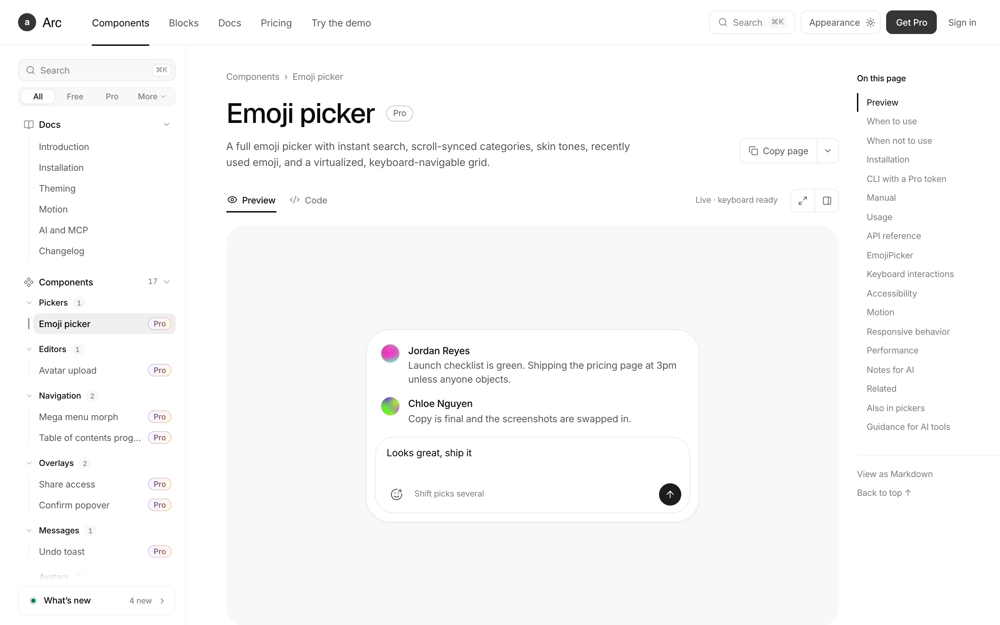

<p align="center">
  
</p>

<p align="center">
  
  
  
  
  
</p>

<p align="center">
  <a href="#quick-start">Quick start</a> ·
  <a href="#layout">Layout</a> ·
  <a href="#use-it-from-an-ai-agent">MCP &amp; skill</a> ·
  <a href="#how-it-was-reconstructed">Method</a> ·
  <a href="REPORT.md">Report</a> ·
  English ·
  <a href="./README.zh-CN.md">简体中文</a>
</p>

# uiarc-pro-reverse

[uiarc.dev](https://uiarc.dev) sells a component library and keeps the source behind a Pro account. The
preview frame, however, has to ship the component to the browser. This repo reconstructs that source:
**233 gated items** rebuilt as plain React you can read, run and diff, plus the **147 free registry
items** copied verbatim. Every id has docs, and 233 of them have a live preview page.

```
233 Pro items   17 components · 113 blocks · 103 special components
147 free items  vendored from the public registry
380 ids total   mean pixel parity 99.91 · 196 items ≥ 99.95 · 139 tree-identical
```

## Quick start

```bash
pnpm install
pnpm dev        # http://localhost:5183
pnpm build      # tsc --noEmit && vite build
```

| Route | Renders |
| --- | --- |
| `/components/<id>` | components and special components |
| `/components/blocks/<id>` | blocks |
| `/frame/<id>` | the bare preview used by the parity gates |

## Layout

| Path | Contents |
| --- | --- |
| `src/components/arc/<id>/` | one item: `<id>.tsx`, `<id>.module.css` (de-hashed, declarations kept), `demo.tsx` |
| `src/site/` | the docs shell: sidebar, item pages, Code tab, markdown, in-page nav |
| `src/components/arc/foundation.css` | design tokens from the public registry |
| `ai/` | MCP server, skill, catalogue index, installer |
| `public/` | image fixtures (18 MB) and 267 markdown docs |
| `scripts/` | capture, parity gates, corpus report, smoke test |

Nothing fetches a registry at runtime: the Code tab reads local files through `import.meta.glob`.

## Use it from an AI agent

The site's own MCP needs an account and returns Pro source only on a paid plan. This repo ships a local
equivalent that knows all 380 ids.

```bash
cd ai/mcp && pnpm install && cd ../..   # once: MCP SDK + zod
node ai/build.mjs                       # rebuild index.json and the skill
node ai/install.mjs --dsh               # or --claude, --cursor, --vscode, --codex, --all
```

| Tool | Returns |
| --- | --- |
| `search_components` | intent → ids, with what each is for and what to use instead |
| `list_components` | 55 groups |
| `get_component` | docs, source, or both; `section` to narrow |
| `get_install_command` | how to bring an item into another project |
| `get_skill` | any skill file, including `catalog/<group>.md` |

The skill (`ai/skill/arc-pro/`) carries the design rules, the full catalogue, and six playbooks for
whole-surface work: page generation, design system, refactor, motion, responsive, accessibility.
It is a stdio process spawned by the client — no daemon, no port, no network.

## How it was reconstructed

1. **Capture** — Playwright opens `/components/<id>/frame` and keeps the SSR DOM, the item's CSS Module
   and the webpack chunk holding its implementation.
2. **De-hash** — `.block_someClass__a1b2c` becomes `.someClass`; keyframes and at-rules survive.
3. **Port** — props, state machine, spring parameters, ARIA, keyboard model, canvas/WebGL renderers,
   seeded data, breakpoints.
4. **Gate** — pixel diff of both frames plus a structural walk (path, tag, box ±1px, text, role, aria),
   then interaction A/B probes on every state.
5. **Report** — both gates over the corpus in sharded parallel runs → [REPORT.md](REPORT.md).

Details, per-item compensations and every known residue: [METHOD.md](METHOD.md).

## Verification

```bash
node scripts/dom-diff.mjs <id>            # structural parity
STABLE=1 node scripts/compare.mjs <id>    # pixel parity, target ≥ 99
node scripts/report.mjs                   # the whole table
node scripts/smoke.mjs                    # every page: 200, preview, code, 0 console errors
```

Eight items land below 99.5 and none of them misses a feature: an undamped orbit that also scores ~96
against *itself*, a randomised text reveal, live clock digits, a 17-second race, a spinning wheel, WebGL
fluid noise, per-cell RNG and a clock lead. All measured, all documented.

## Credit

Design, layout and component ideas belong to **[Arc / uiarc.dev](https://uiarc.dev)**. This is a
reverse-engineering study for reading and porting practice, not a redistribution of the original source.
For the supported and licensed version, buy the original.
