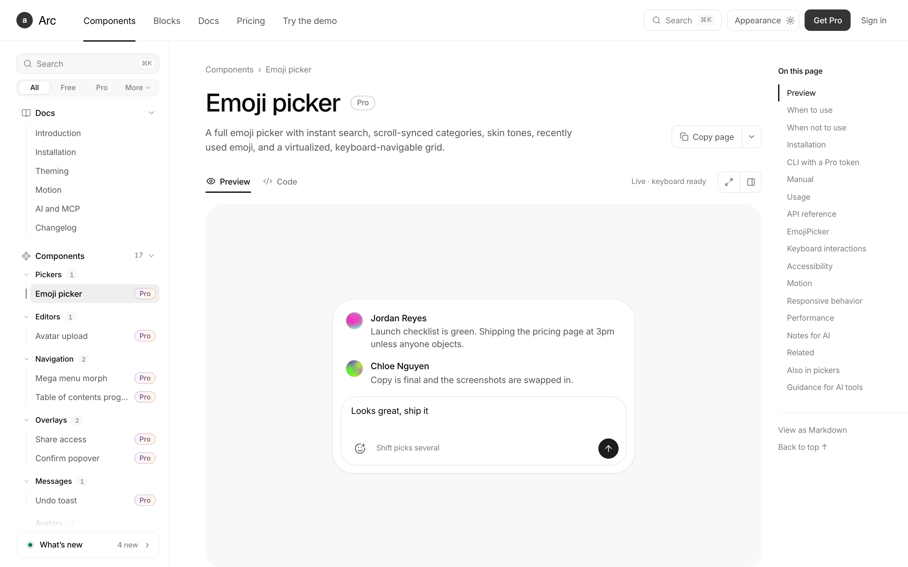

<p align="center">
  
</p>

<p align="center">
  
  
  
  
  
</p>

<p align="center">
  <a href="#快速开始">快速开始</a> ·
  <a href="#目录结构">目录结构</a> ·
  <a href="#给-ai-agent-使用">MCP 与 skill</a> ·
  <a href="#怎么还原的">还原方法</a> ·
  <a href="REPORT.md">验证报告</a> ·
  <a href="./README.md">English</a> ·
  简体中文
</p>

# uiarc-pro-reverse

[uiarc.dev](https://uiarc.dev) 的组件库源码锁在 Pro 账户后面，但预览帧必须把组件发给浏览器才能渲染。
本仓库就是从这份投递产物里把源码还原出来：**233 个付费条目**重建为可直接阅读、运行、对比的 React 代码，
另附 **147 个免费条目**的逐字节副本。每个 id 都有文档，其中 233 个有在线预览页。

```
233 个 Pro   17 个组件 · 113 个区块 · 103 个特殊组件
147 个免费    取自公开 registry，逐字节保留
共 380 个    平均像素一致度 99.91 · 196 项 ≥ 99.95 · 139 项 DOM 完全一致
```

## 快速开始

```bash
pnpm install
pnpm dev        # http://localhost:5183
pnpm build      # tsc --noEmit && vite build
```

| 路由 | 渲染内容 |
| --- | --- |
| `/components/<id>` | 组件与特殊组件 |
| `/components/blocks/<id>` | 区块 |
| `/frame/<id>` | 用于一致性校验的裸预览 |

## 目录结构

| 路径 | 内容 |
| --- | --- |
| `src/components/arc/<id>/` | 单个条目：`<id>.tsx`、`<id>.module.css`（去哈希，声明原样保留）、`demo.tsx` |
| `src/site/` | 文档站外壳：侧边栏、条目页、Code 标签、Markdown、页内导航 |
| `src/components/arc/foundation.css` | 取自公开 registry 的设计变量 |
| `ai/` | MCP 服务、skill、目录索引、安装器 |
| `public/` | 图片素材（18 MB）与 267 份 Markdown 文档 |
| `scripts/` | 抓取、一致性闸门、全量报告、冒烟测试 |

运行时不会请求任何 registry：Code 标签通过 `import.meta.glob` 读取本地文件。

## 给 AI agent 使用

官网自带的 MCP 需要账号，且只有付费才返回 Pro 源码。本仓库内置一份本地等价物，认识全部 380 个 id。

```bash
cd ai/mcp && pnpm install && cd ../..   # 一次性：MCP SDK + zod
node ai/build.mjs                       # 重建 index.json 与 skill
node ai/install.mjs --dsh               # 也可 --claude、--cursor、--vscode、--codex、--all
```

| 工具 | 返回 |
| --- | --- |
| `search_components` | 需求 → 一批 id，附带用途与「别用它，用哪个」 |
| `list_components` | 55 个分组 |
| `get_component` | 文档、源码或两者，可用 `section` 收窄 |
| `get_install_command` | 把条目搬进别的项目的方式 |
| `get_skill` | 任意 skill 文件，含 `catalog/<group>.md` |

`ai/skill/arc-pro/` 里放着设计规则、完整目录，以及六份面向整页任务的 playbook：页面生成、设计系统、
重构迁移、动效、响应式、可访问性。它是客户端拉起的 stdio 进程——没有守护进程、没有端口、不联网。

## 怎么还原的

1. **抓取** — Playwright 打开 `/components/<id>/frame`，留下 SSR DOM、该条目的 CSS Module、以及包含其实现的 webpack chunk。
2. **去哈希** — `.block_someClass__a1b2c` → `.someClass`，关键帧与嵌套 at-rule 原样保留。
3. **移植** — props、状态机、弹簧参数、ARIA、键盘模型、canvas/WebGL 渲染、种子数据、断点。
4. **校验** — 两帧像素差 + 结构遍历（path、tag、盒模型 ±1px、文本、role、aria），再对每个状态做交互 A/B。
5. **报告** — 两个闸门全量分片跑完写进 [REPORT.md](REPORT.md)。

逐项补偿与全部已知残差见 [METHOD.md](METHOD.md)。

## 验证

```bash
node scripts/dom-diff.mjs <id>            # 结构一致性
STABLE=1 node scripts/compare.mjs <id>    # 像素一致性，目标 ≥ 99
node scripts/report.mjs                   # 全量表
node scripts/smoke.mjs                    # 每页 200、预览挂载、代码存在、0 报错
```

有 8 项低于 99.5，没有一项是缺功能：一个无阻尼轨道（它和自己比也只有约 96）、随机文本揭示、实时时钟数字、
17 秒的长赛跑、旋转轮盘、WebGL 流体噪点、逐格随机、时钟提前量。全部有测量、有记录。

## 致谢与声明

设计与组件创意归 **[Arc / uiarc.dev](https://uiarc.dev)** 所有。本仓库是逆向工程研究，用于阅读与移植练习，
不是原始源码的再分发。需要受支持、有授权的版本，请购买原版。
